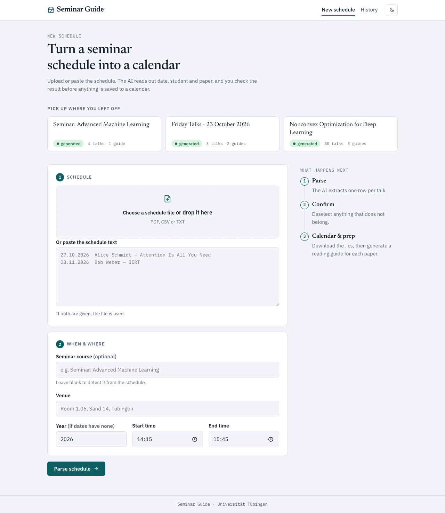
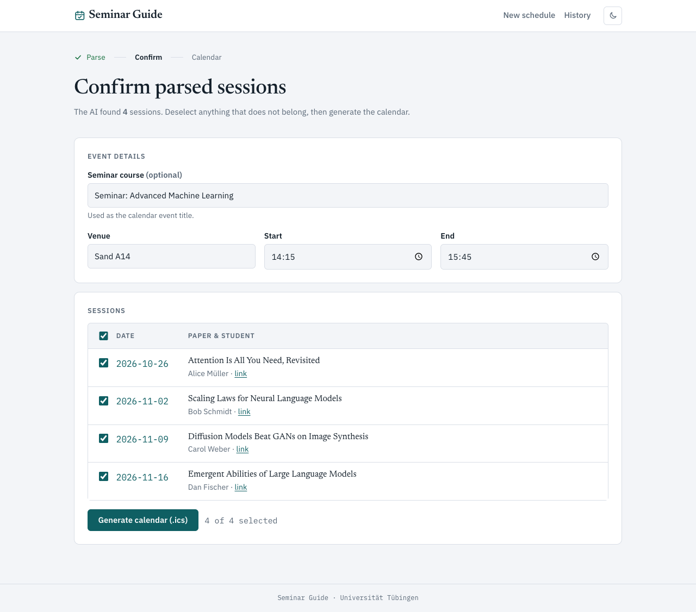
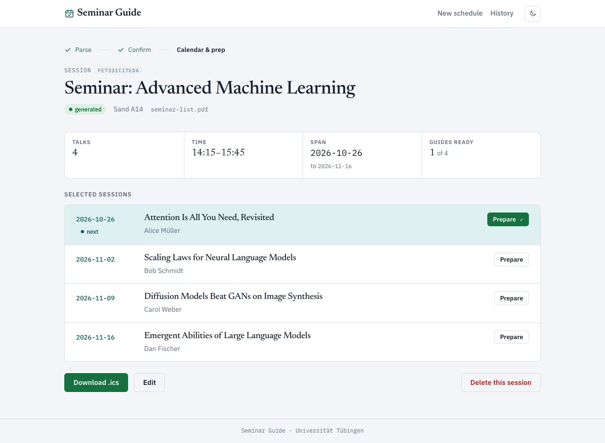
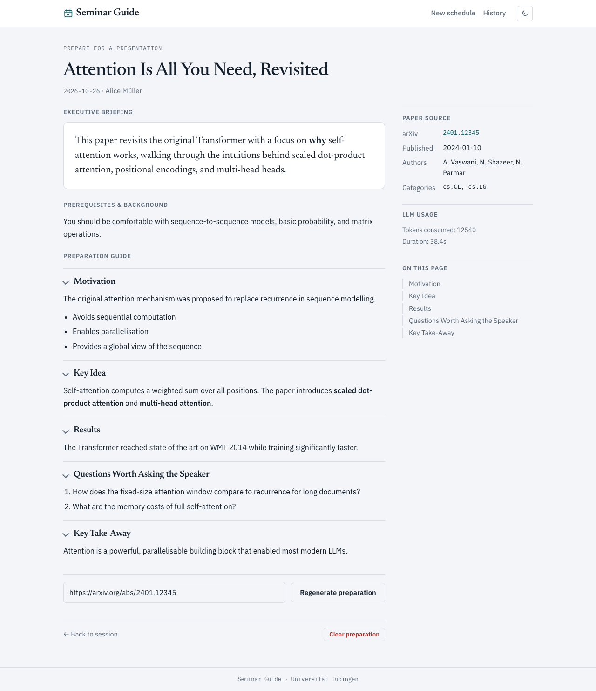
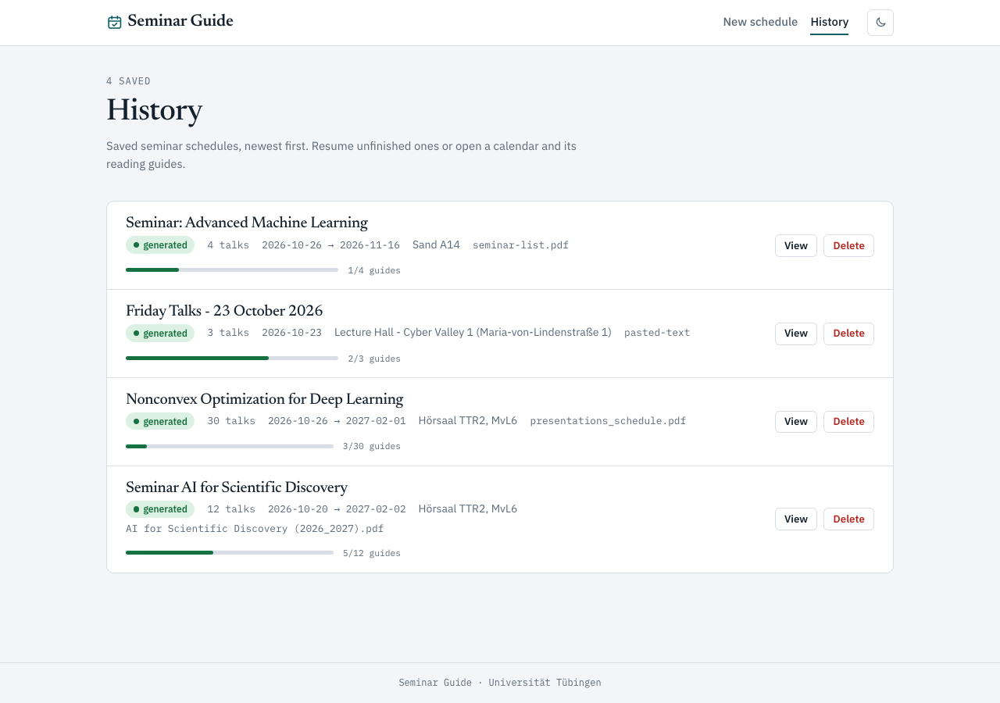

# Seminar Guide

Seminar Guide turns a seminar schedule into an ICS calendar and AI-generated per-paper reading guides. Upload or paste a schedule, let the LLM extract each session's date, presenter and paper, review the result, generate a calendar, and then build a preparation guide for every talk — including the questions you might want to ask the speaker.

Built with **FastAPI**, server-rendered **Jinja2** templates, and flat-file JSON storage (no database). All LLM calls go through an OpenAI-compatible HTTP API.

## Screenshots

| New schedule | Confirm parsed sessions |
|---|---|
|  |  |

| Session & calendar | Preparation guide |
|---|---|
|  |  |

| History |
|---|
|  |

## Features

- **Schedule parsing** — Upload a PDF (extracted with PyMuPDF) or paste raw text; an LLM extracts `date`, `presenter`, `paper title`, and any paper URL into structured rows.
- **Confirm & edit** — Review the parsed rows, correct dates/names/titles, select exactly which sessions go into the calendar.
- **ICS calendar generation** — Generate a downloadable `.ics` calendar. Talks sharing a date are grouped into a single event with each student/paper listed in the description.
- **Per-paper preparation guides** — For each talk, the app resolves the paper (arXiv search or a direct article/PDF URL), downloads and truncates the text, and generates AI sections plus an executive briefing.
- **Pause / resume / regenerate** — Long-running guide generation can be paused, resumed (only unfinished sections are generated), or regenerated from scratch.
- **Session history** — Past seminars are saved and listed with preparation progress, so you can pick up where you left off.
- **Markdown rendering** — AI output is rendered as sanitized Markdown (via `bleach`); fenced code and sane lists are supported.

## How it works

The pipeline is **parse → generate (calendar) → prepare (per-paper guide)**:

```
index (/) → POST /parse → /confirm/{sid}
/confirm → POST /generate/{sid} → /session/{sid}
/session/{sid} → POST /prepare/{sid}/{row}/generate → /prepare/{sid}/{row}
```

1. **Parse** — an uploaded file or pasted text is converted to text (`app/extract.py`, `app/document_parser.py`) and sent to the LLM in JSON mode (`app/llm.py::parse_schedule`). The parsed rows are persisted.
2. **Generate** — the user selects rows; `app/ics.py::build_calendar` groups same-date rows into one `.ics` VEVENT. The selection and calendar are saved.
3. **Prepare** — a background thread resolves the paper (arXiv search or direct URL), downloads/truncates the paper text, and:
   - asks the LLM for section titles,
   - appends two fixed sections (`Questions Worth Asking the Speaker`, `Key Take-Away`),
   - generates the AI sections concurrently (`ThreadPoolExecutor(max_workers=4)`),
   - writes one closing request that produces the fixed sections and the executive briefing,
   - saves each section individually and marks the state `complete` when done.

Generation state lives in `preparation/<row_index>.state.json` and supports `running`, `paused`, `complete`, and `error` statuses.

## Tech stack

- **Web**: FastAPI + Uvicorn, Jinja2 server-rendered templates
- **Documents**: PyMuPDF (PDF → Markdown), trafilatura (HTML → Markdown)
- **LLM**: `openai` client against any OpenAI-compatible API
- **Calendar**: `icalendar`
- **Config**: `pydantic-settings`
- **Markdown**: `markdown` + `bleach`
- **HTTP**: `httpx`
- **Tests**: `pytest`

## Getting started

### Prerequisites

- Python 3.10+ (the project venv at `.venv` uses 3.14)
- An OpenAI-compatible API endpoint (e.g. OpenAI, or a local OpenAI-compatible server)

### Installation

```bash
# Create and activate a virtualenv (or use the existing .venv)
python -m venv .venv
source .venv/bin/activate

# Install dependencies
pip install -r requirements.txt
```

### Configuration

Copy the example environment file and fill in your values:

```bash
cp .env.example .env
```

| Variable | Default | Description |
|---|---|---|
| `LLM_BASE_URL` | `https://api.openai.com/v1` | Base URL of the OpenAI-compatible API. |
| `LLM_API_KEY` | *(empty)* | API key (required for real LLM calls). |
| `LLM_MODEL` | `gpt-4o-mini` | Model used for parsing and preparation. |
| `ARXIV_TIMEOUT_SECONDS` | `20` | HTTP timeout for arXiv/article requests. |

`.env` is gitignored; `.env.example` is the reference for the expected keys.

### Running the app

```bash
# From the repo root (prefer .venv/bin/python over system python)
.venv/bin/python -m uvicorn app.main:app --reload
```

Then open <http://127.0.0.1:8000/>.

## Tests

The test suite uses pytest and covers configuration, ICS generation, storage, parsing/extraction, the LLM layer, routes, history, and the preparation state machine (including concurrent section generation and pause/resume).

```bash
.venv/bin/python -m pytest tests/ -q

# Run a single module or test
.venv/bin/python -m pytest tests/test_prepare.py -q
.venv/bin/python -m pytest tests/test_prepare.py::test_pause_during_generation_resumes_remaining
```

Tests run fully offline: LLM calls are stubbed with fake clients returning canned JSON, arXiv HTTP is mocked, and session storage is pointed at `tmp_path`.

## Project layout

| Path | Purpose |
|---|---|
| `app/main.py` | FastAPI app, all routes, background preparation orchestration, concurrency locks, markdown/bleach rendering. |
| `app/llm.py` | All LLM calls, prompt loading, thread-local usage reporting, preparation generators. |
| `app/storage.py` | JSON persistence, session/preparation CRUD, atomic writes. |
| `app/config.py` | `pydantic-settings` `Settings`; `get_settings()` is cached. |
| `app/arxiv.py` | arXiv search, PDF/HTML fetching, paper text extraction. |
| `app/document_parser.py` | PDF → Markdown (PyMuPDF) and HTML → Markdown (trafilatura). |
| `app/extract.py` | Converts an uploaded file/PDF or raw text to Markdown for parsing. |
| `app/ics.py` | Calendar generation. |
| `app/prompts/*.md` | Prompt templates for schedule parsing and every preparation step. |
| `templates/` | Jinja2 server-rendered UI (extends `base.html`). |
| `docs/` | README screenshots captured from the running app. |
| `tests/` | pytest suite, one module per feature area. |
| `data/sessions/` | Runtime JSON storage (gitignored; one 12-hex dir per session). |

## Storage

All data is stored as JSON files under `data/sessions/<sid>/` (no database). Per session:

- `meta.json`, `raw.txt`, `parsed.json`, `selected.json`, `calendar.ics`
- `preparation/` with per-row state (`<row>.state.json`), individual sections (`<row>.sections/<i>.json`), and the final guide (`<row>.json`)

## Disclaimer

This is a pure personal project and is not affiliated with any university or seminar series. The LLM-generated content is for educational purposes only and may contain inaccuracies. Always verify information from primary sources. This project is a pure vibe-code.
